# Supreme Trading Terminal

Public results for a local options terminal. From January 2020 through August 2025 it runs four option strategies on SPX, SPY, QQQ, and DIA, and shows volatility, where option exposure sits, and which strikes to use.

This page keeps the results, the screens, and a short note on what went into them.

## Which book each ticker uses

Same sample, same entry and exit rule. The book below is the one that looks best once Sharpe and max drawdown are read together.

| Ticker | Book | Sharpe | Max drawdown | Annual return |
|---|---|---:|---:|---:|
| SPX | Iron condor | 1.77 | −16.4% | 49.7% |
| SPY | Short put | 1.86 | −25.5% | 72.2% |
| QQQ | Short put | 1.56 | −40.3% | 71.4% |
| DIA | Short put | 0.83 | −58.1% | 34.0% |

On SPX the short put also has a Sharpe of 1.77, with a −27.6% drawdown. The condor loss is capped and the drawdown is smaller, so SPX uses the condor. On SPY, QQQ, and DIA the short put has a higher Sharpe than the covered call and the condor. On DIA that Sharpe is still the highest of the three, and the drawdown is the deepest.

The call ratio backspread has a higher Sharpe (SPX 2.15, SPY 2.33, QQQ 2.29). Its capital is only the maximum loss of a tight spread, so the percentage drawdown goes past 100%. That drawdown is not compared with the table above.

## How to read the numbers

- The window is **2020-01-02 to 2025-08-29**. The rules and the results use the same sample. Most of it is a bull market, with 2022 as the bear year.
- Fills use the bid and the ask. Broker fees are already deducted.
- Return and Sharpe use the margin occupied that day, and only days with a position open. Sharpe deducts a 3.9% funding rate.
- The condor's cumulative return and max drawdown compound each day's return. The other three books add the daily returns.
- Dollar PnL scales with contract size. Do not compare SPX dollars with the ETFs. Compare Sharpe and drawdown.
- Blue on the charts is calm. Red is stressed.
- Research record, not investment advice. Past results do not predict future results.

β is how closely the book's return moves with the underlying on days a position is open. Above 1, the same index move shows up as a larger percentage return on the book.

| Strategy | SPX | SPY | QQQ | DIA |
|---|---:|---:|---:|---:|
| Iron condor | 0.80 | 0.77 | 0.67 | 1.09 |
| Short put | 2.14 | 2.13 | 1.96 | 2.28 |
| Covered call | — | 2.66 | 2.57 | 2.94 |
| Call ratio backspread | 11.23 | 10.99 | 9.37 | — |

The short put and the covered call mostly follow the index while a position is open. The condor follows it much less. The backspread's β reaches double digits because the capital it ties up is small relative to the index, so the same move is a much larger percentage.

## The terminal

It opens in a browser. The monitor accepts other US tickers. The four strategies run only on SPX, SPY, QQQ, and DIA.

<table>
<tr>
<td width="50%" align="center"><b>Volatility</b> How much volatility the market is pricing across expiries and strikes, and how the implied move compares with the historical move. 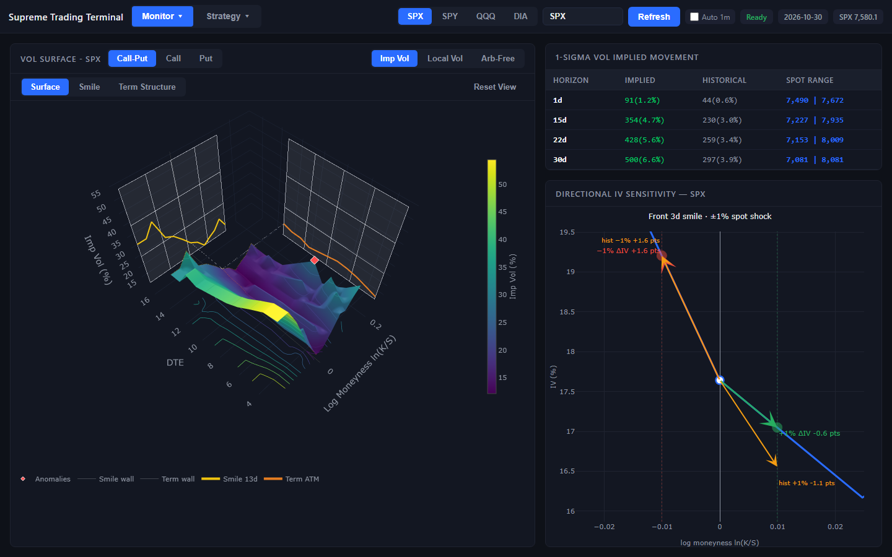</td>
<td width="50%" align="center"><b>Exposure by strike</b> Where option exposure is concentrated, whether the net is long or short, and where that net flips. 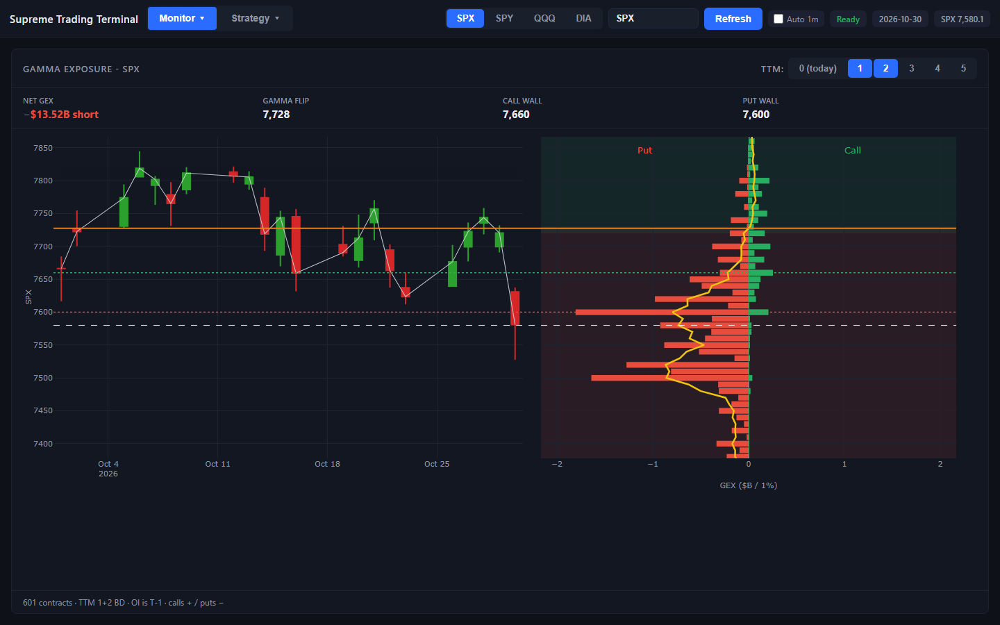</td>
</tr>
<tr>
<td width="50%" align="center"><b>Volatility regime</b> Whether the market is calm or stressed. All four books open when it is calm and close what is still open when it turns stressed. 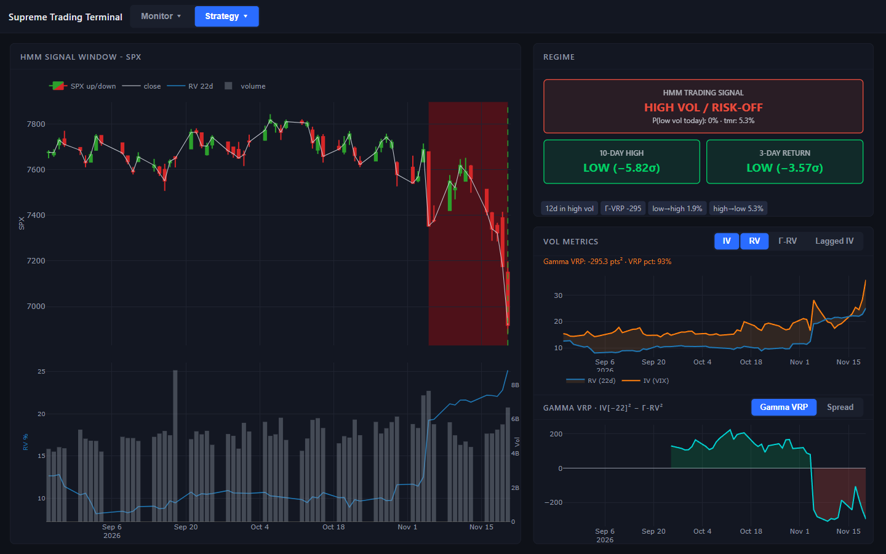</td>
<td width="50%" align="center"><b>Strikes</b> A set of strikes and the payoff at expiry, plus the credit, the maximum loss, and the breakevens for that trade. 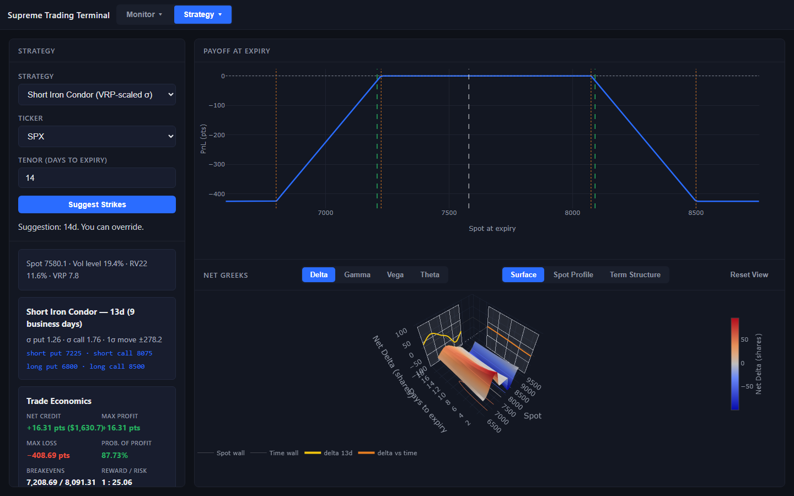</td>
</tr>
</table>

## Iron condor

When the market is calm and the trade collects a net credit, sell a range with protection on both sides, about two weeks out, with more room on the upside. Close everything when the market turns stressed. Run on all four tickers.

| Ticker | Sharpe | Annual return | Annual volatility | Max drawdown | Cumulative return | Total PnL | Peak margin |
|---|---:|---:|---:|---:|---:|---:|---:|
| SPX | **1.77** | 49.7% | 25.9% | −16.4% | 503.5% | $805,112 | $782,820 |
| SPY | **1.39** | 39.5% | 25.5% | −16.2% | 310.0% | $67,455 | $70,432 |
| QQQ | **0.98** | 37.4% | 34.3% | −26.2% | 257.1% | $74,294 | $72,812 |
| DIA | **0.45** | 17.3% | 29.8% | −38.5% | 60.8% | $45,345 | $63,025 |

<table>
<tr>
<td width="50%" align="center"><b>SPX</b> · Sharpe 1.77 · drawdown −16.4% 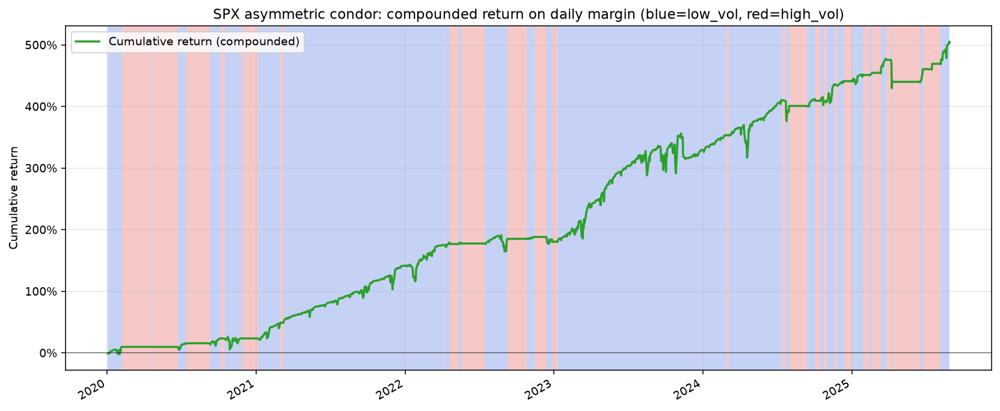</td>
<td width="50%" align="center"><b>SPY</b> · Sharpe 1.39 · drawdown −16.2% 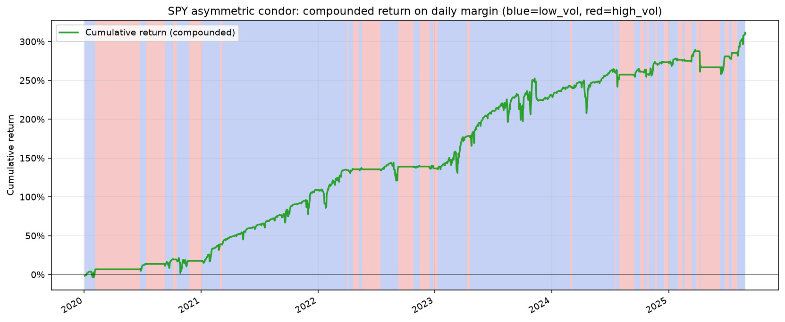</td>
</tr>
<tr>
<td width="50%" align="center"><b>QQQ</b> · Sharpe 0.98 · drawdown −26.2% 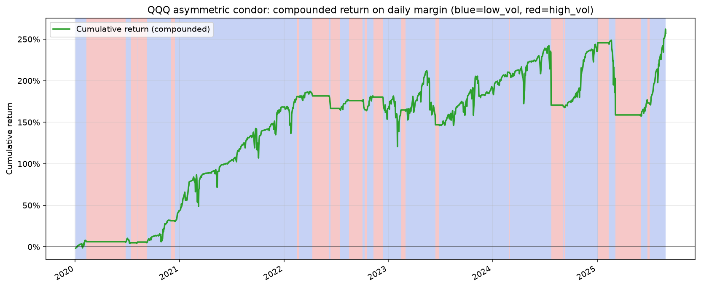</td>
<td width="50%" align="center"><b>DIA</b> · Sharpe 0.45 · drawdown −38.5% 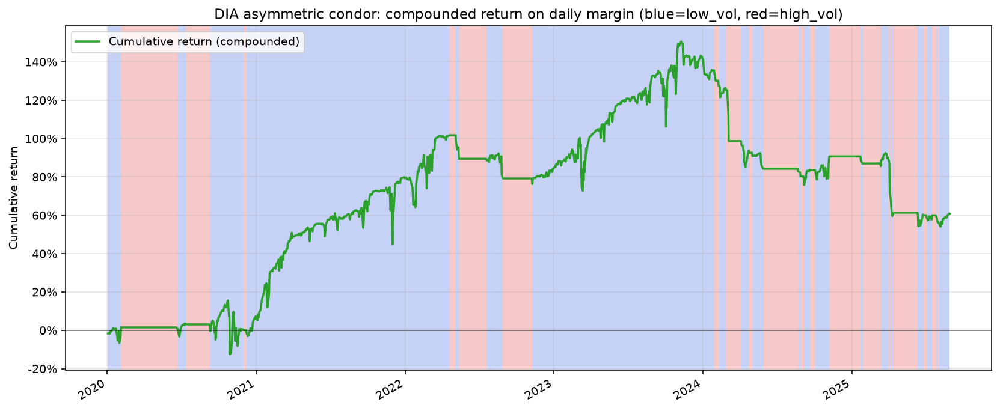</td>
</tr>
</table>

## Short put

On every calm close, sell one put. Open puts can stack. If one put loses the premium it was paid, that put is stopped. Close every open put when the market turns stressed. Run on all four tickers.

| Ticker | Sharpe | Annual return | Annual volatility | Max drawdown | Total PnL | Peak margin |
|---|---:|---:|---:|---:|---:|---:|
| SPX | **1.77** | 68.6% | 36.6% | −27.6% | $2,147,002 | $2,425,373 |
| SPY | **1.86** | 72.2% | 36.7% | −25.5% | $217,777 | $253,061 |
| QQQ | **1.56** | 71.4% | 43.4% | −40.3% | $256,081 | $238,927 |
| DIA | **0.83** | 34.0% | 36.4% | −58.1% | $141,414 | $206,594 |

<table>
<tr>
<td width="50%" align="center"><b>SPX</b> · Sharpe 1.77 · drawdown −27.6% 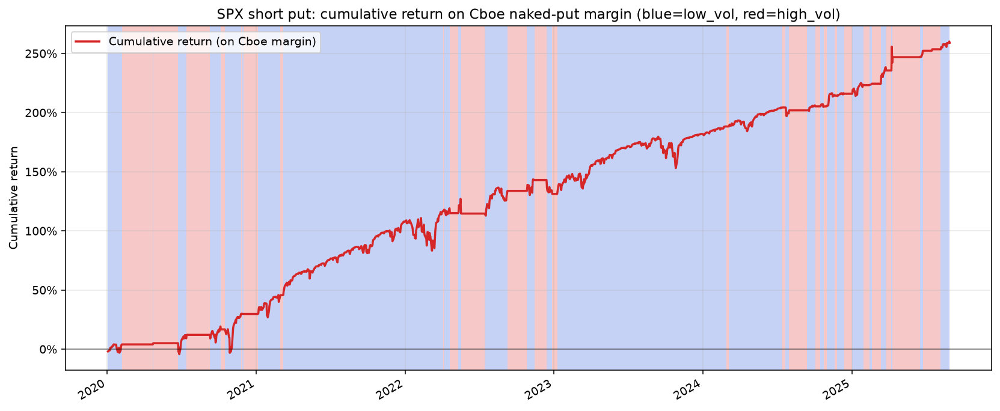</td>
<td width="50%" align="center"><b>SPY</b> · Sharpe 1.86 · drawdown −25.5% </td>
</tr>
<tr>
<td width="50%" align="center"><b>QQQ</b> · Sharpe 1.56 · drawdown −40.3% </td>
<td width="50%" align="center"><b>DIA</b> · Sharpe 0.83 · drawdown −58.1% </td>
</tr>
</table>

## Covered call

On every calm close, buy the ETF and sell one call. Open packages can stack. If one package loses the premium it was paid, that package is stopped. Close every open package when the market turns stressed. SPX has no ETF to hold, so it is not run.

| Ticker | Sharpe | Annual return | Annual volatility | Max drawdown | Cumulative return | Total PnL | Peak margin |
|---|---:|---:|---:|---:|---:|---:|---:|
| SPY | **1.57** | 72.3% | 43.4% | −38.7% | 274.7% | $527,574 | $1,099,343 |
| QQQ | **1.47** | 83.5% | 54.0% | −56.8% | 332.9% | $420,285 | $963,442 |
| DIA | **0.62** | 30.1% | 42.1% | −45.6% | 109.2% | $266,673 | $842,321 |

<table>
<tr>
<td width="33%" align="center"><b>SPY</b> · Sharpe 1.57 · drawdown −38.7% 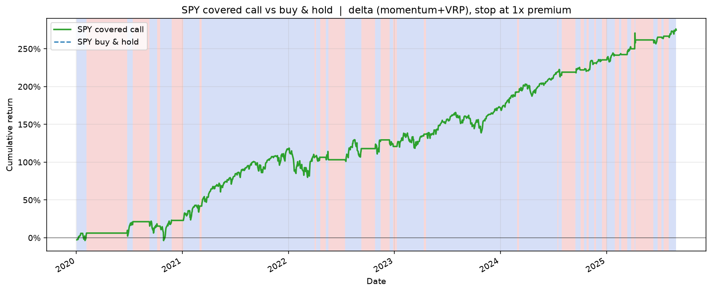</td>
<td width="33%" align="center"><b>QQQ</b> · Sharpe 1.47 · drawdown −56.8% 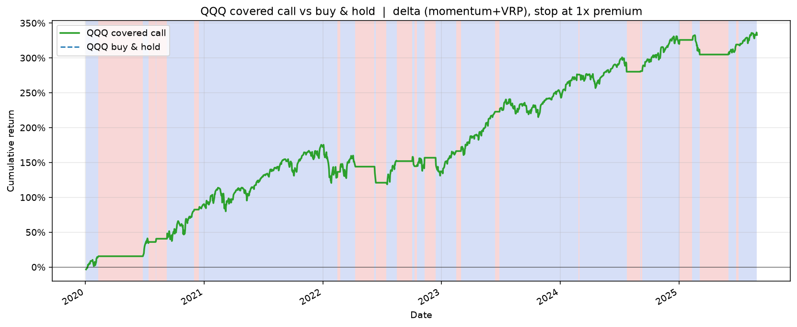</td>
<td width="33%" align="center"><b>DIA</b> · Sharpe 0.62 · drawdown −45.6% 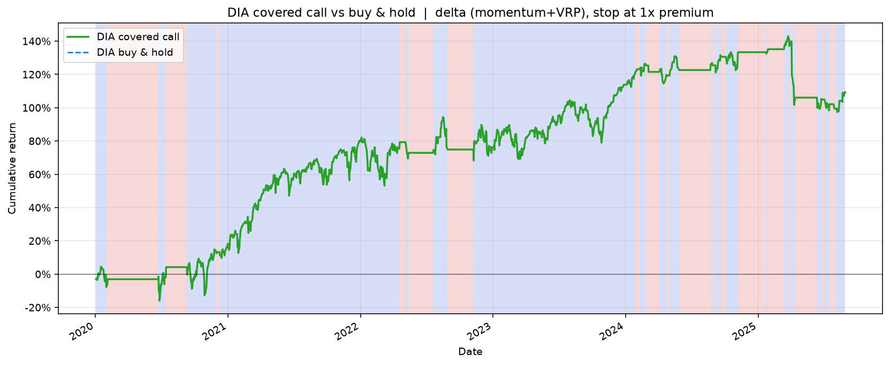</td>
</tr>
</table>

## Call ratio backspread

Open when the market is calm and price has fallen clearly from a recent high, as a bet on a bounce, held for about a week. Open spreads can stack. DIA's option quotes are too wide for the round trip, so DIA is not run.

The percentage drawdown goes past 100% because the denominator is the maximum loss of that tight spread, and each day's gain or loss is added on that small base. Dollar results are the total PnL in the table.

| Ticker | Sharpe | Annual (days in the market) | Annual (calendar) | Annual volatility | Max drawdown | Cumulative return | Total PnL | Peak margin |
|---|---:|---:|---:|---:|---:|---:|---:|---:|
| SPX | **2.15** | 531.1% | 219.8% | 245.3% | −159.8% | 1243.4% | $178,960 | $97,220 |
| SPY | **2.33** | 571.7% | 244.3% | 244.2% | −167.0% | 1381.7% | $21,317 | $8,966 |
| QQQ | **2.29** | 596.2% | 275.2% | 259.0% | −128.9% | 1556.7% | $16,755 | $9,873 |

<table>
<tr>
<td width="33%" align="center"><b>SPX</b> · Sharpe 2.15 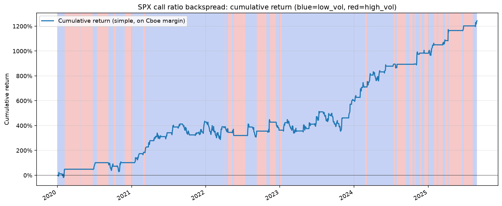</td>
<td width="33%" align="center"><b>SPY</b> · Sharpe 2.33 </td>
<td width="33%" align="center"><b>QQQ</b> · Sharpe 2.29 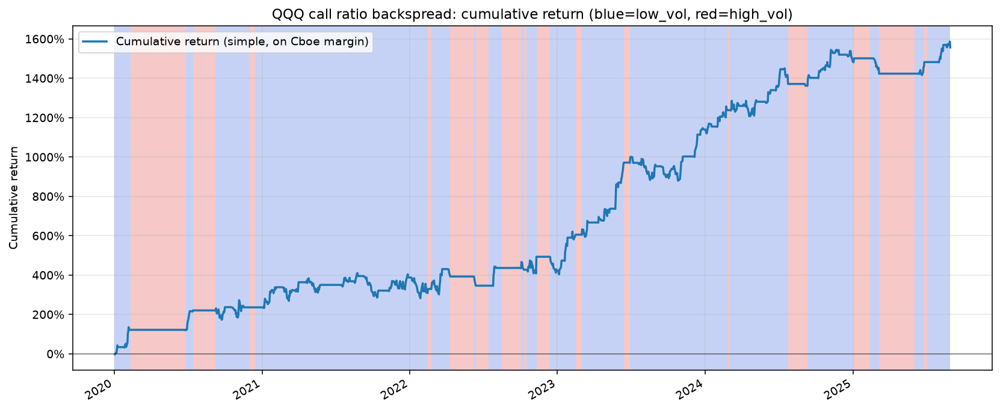</td>
</tr>
</table>

## What it uses

- A web terminal that runs on this machine, for reading the market and picking strikes.
- US option quotes, the underlying price, and VIX, VXN, and VXD.
- A calm-or-stressed read of the market, used to open and to close.
- Four option books. In a calm market new positions can be added; when the market turns stressed, open positions are closed.
- A historical backtest from early 2020 through August 2025, with bid/ask fills and fees included.
