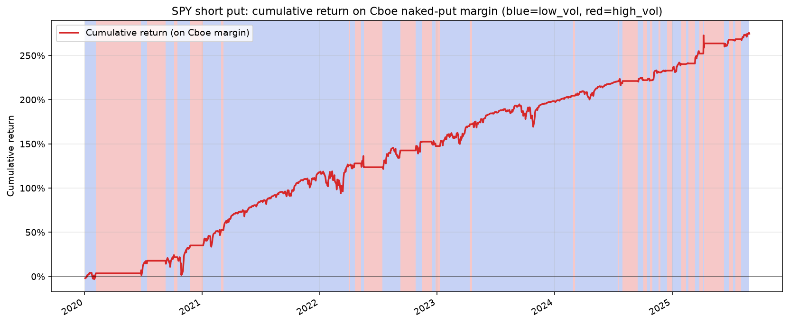
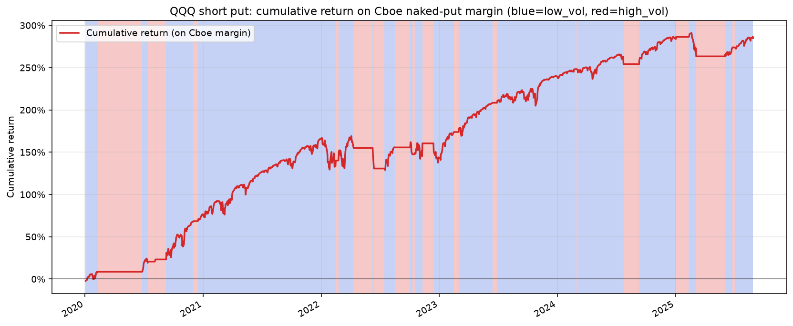
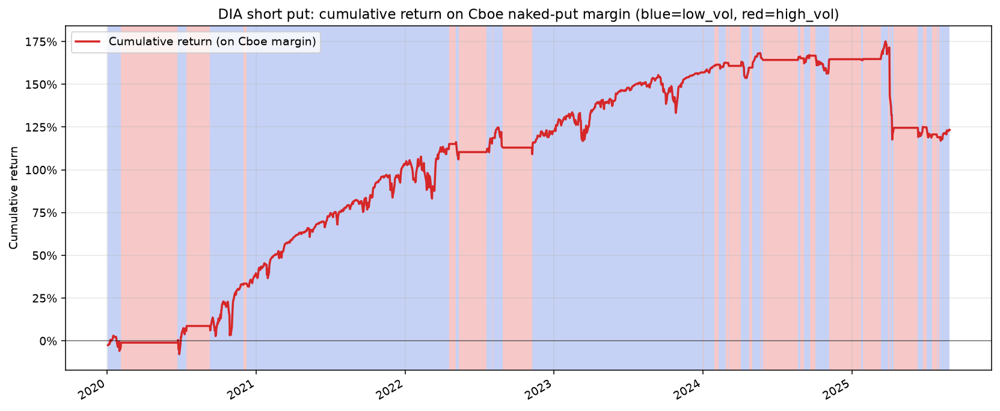
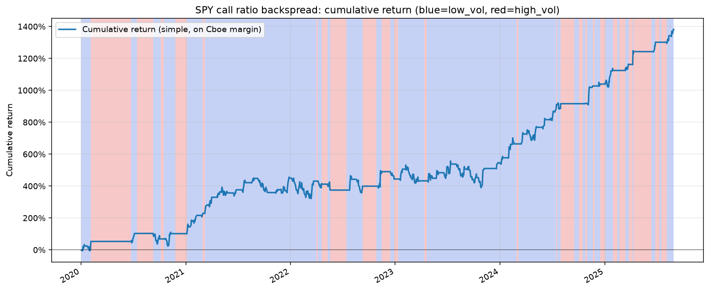

# Supreme Trading Terminal

本地期权终端的公开成果页。2020 年 1 月到 2025 年 8 月，在 SPX、SPY、QQQ、DIA 上跑了四套期权策略，并做了一个用来看波动率、仓位分布和行权价的终端。

这里只放做了什么、成绩和界面。

## 每个标的用哪一套

同一段行情、同一套进出场规则。留下的那一套，是夏普和最大回撤放在一起看之后的选择。

| 标的 | 采用 | 夏普 | 最大回撤 | 年化收益 |
|---|---|---:|---:|---:|
| SPX | 铁鹰 | 1.77 | −16.4% | 49.7% |
| SPY | 卖出看跌 | 1.86 | −25.5% | 72.2% |
| QQQ | 卖出看跌 | 1.56 | −40.3% | 71.4% |
| DIA | 卖出看跌 | 0.83 | −58.1% | 34.0% |

SPX 上卖出看跌的夏普也是 1.77，回撤 −27.6%。铁鹰亏损有上限，回撤更小，所以 SPX 用铁鹰。SPY、QQQ、DIA 上，卖出看跌的夏普高于备兑和铁鹰。DIA 这份夏普仍是三套里最高的，回撤也是最深的。

看涨比率价差的夏普更高（SPX 2.15、SPY 2.33、QQQ 2.29）。它占用的资金只是一笔窄价差的最大亏损，百分比回撤会超过 100%，不和上表放在一起比。

## 这些数字怎么读

- 区间是 **2020-01-02 至 2025-08-29**。规则和成绩用的是同一段数据。这段里大部分时间是牛市，2022 年是熊市。
- 成交按买价和卖价计算，券商费用已经扣掉。
- 收益和夏普按当天占用的保证金计算，只统计有仓的交易日。夏普扣除了 3.9% 的资金成本。
- 铁鹰的累计收益和最大回撤按每天收益复利。其余三套把每天的收益相加。
- 盈亏金额随合约大小变化。SPX 的美元盈亏不要和 ETF 直接比，横向比较看夏普和回撤。
- 图中蓝色是平静，红色是紧张。
- 这是研究记录，不是投资建议。过去的成绩不代表以后。

有仓的日子里，策略收益和标的涨跌的联动用 β 表示。大于 1，表示同样的指数波动换成策略的百分比收益会更大。

| 策略 | SPX | SPY | QQQ | DIA |
|---|---:|---:|---:|---:|
| 铁鹰 | 0.80 | 0.77 | 0.67 | 1.09 |
| 卖出看跌 | 2.14 | 2.13 | 1.96 | 2.28 |
| 备兑 | — | 2.66 | 2.57 | 2.94 |
| 看涨比率价差 | 11.23 | 10.99 | 9.37 | — |

卖出看跌和备兑在有仓时大部分跟着指数走。铁鹰弱很多。看涨比率价差的 β 到两位数，是因为占用资金相对指数很小，同样的涨跌换成百分比会被放大。

## 终端

在浏览器里打开。监控可以换其他美股代码；下面四套策略只跑 SPX、SPY、QQQ、DIA。

<table>
<tr>
<td width="50%" align="center"><b>波动率</b> 不同到期、不同行权价上，市场正在给多高的波动率，以及未来一段的隐含波幅和历史波幅差多少。 </td>
<td width="50%" align="center"><b>仓位分布</b> 期权仓位集中在哪些价位，净敞口偏多还是偏空，以及多空切换的位置。 </td>
</tr>
<tr>
<td width="50%" align="center"><b>波动率环境</b> 市场处在平静还是紧张。四套策略都在平静时开仓，转紧张时把未平仓位关掉。 </td>
<td width="50%" align="center"><b>行权价</b> 选定策略后给出一组行权价和到期盈亏，以及这笔交易的权利金、最大亏损和盈亏平衡。 </td>
</tr>
</table>

## 铁鹰

平静、并且能收到净权利金时，卖出一个两端有保护的区间，大约两周，上方留得更宽。紧张时全部平仓。四个标的都做了。

| 标的 | 夏普 | 年化收益 | 年化波动 | 最大回撤 | 累计收益 | 总盈亏 | 峰值保证金 |
|---|---:|---:|---:|---:|---:|---:|---:|
| SPX | **1.77** | 49.7% | 25.9% | −16.4% | 503.5% | $805,112 | $782,820 |
| SPY | **1.39** | 39.5% | 25.5% | −16.2% | 310.0% | $67,455 | $70,432 |
| QQQ | **0.98** | 37.4% | 34.3% | −26.2% | 257.1% | $74,294 | $72,812 |
| DIA | **0.45** | 17.3% | 29.8% | −38.5% | 60.8% | $45,345 | $63,025 |

<table>
<tr>
<td width="50%" align="center"><b>SPX</b> · 夏普 1.77 · 回撤 −16.4% </td>
<td width="50%" align="center"><b>SPY</b> · 夏普 1.39 · 回撤 −16.2% </td>
</tr>
<tr>
<td width="50%" align="center"><b>QQQ</b> · 夏普 0.98 · 回撤 −26.2% </td>
<td width="50%" align="center"><b>DIA</b> · 夏普 0.45 · 回撤 −38.5% </td>
</tr>
</table>

## 卖出看跌

每个平静的收盘卖出一张看跌，未平的可以叠加。单笔亏掉当时收到的权利金，就停掉这一笔。紧张时全部平仓。四个标的都做了。

| 标的 | 夏普 | 年化收益 | 年化波动 | 最大回撤 | 总盈亏 | 峰值保证金 |
|---|---:|---:|---:|---:|---:|---:|
| SPX | **1.77** | 68.6% | 36.6% | −27.6% | $2,147,002 | $2,425,373 |
| SPY | **1.86** | 72.2% | 36.7% | −25.5% | $217,777 | $253,061 |
| QQQ | **1.56** | 71.4% | 43.4% | −40.3% | $256,081 | $238,927 |
| DIA | **0.83** | 34.0% | 36.4% | −58.1% | $141,414 | $206,594 |

<table>
<tr>
<td width="50%" align="center"><b>SPX</b> · 夏普 1.77 · 回撤 −27.6% </td>
<td width="50%" align="center"><b>SPY</b> · 夏普 1.86 · 回撤 −25.5% </td>
</tr>
<tr>
<td width="50%" align="center"><b>QQQ</b> · 夏普 1.56 · 回撤 −40.3% </td>
<td width="50%" align="center"><b>DIA</b> · 夏普 0.83 · 回撤 −58.1% </td>
</tr>
</table>

## 备兑

每个平静的收盘买入 ETF，并卖出一张看涨，未平的可以叠加。单笔亏掉权利金就停掉这一笔。紧张时全部平掉。SPX 没有对应的 ETF，不做。

| 标的 | 夏普 | 年化收益 | 年化波动 | 最大回撤 | 累计收益 | 总盈亏 | 峰值保证金 |
|---|---:|---:|---:|---:|---:|---:|---:|
| SPY | **1.57** | 72.3% | 43.4% | −38.7% | 274.7% | $527,574 | $1,099,343 |
| QQQ | **1.47** | 83.5% | 54.0% | −56.8% | 332.9% | $420,285 | $963,442 |
| DIA | **0.62** | 30.1% | 42.1% | −45.6% | 109.2% | $266,673 | $842,321 |

<table>
<tr>
<td width="33%" align="center"><b>SPY</b> · 夏普 1.57 · 回撤 −38.7% </td>
<td width="33%" align="center"><b>QQQ</b> · 夏普 1.47 · 回撤 −56.8% </td>
<td width="33%" align="center"><b>DIA</b> · 夏普 0.62 · 回撤 −45.6% </td>
</tr>
</table>

## 看涨比率价差

平静、且价格从近端高点明显回落时开仓，做一笔反弹，大约持有一周。未平的可以叠加。DIA 的期权买卖价太宽，这笔来回交易不划算，所以不做。

百分比回撤超过 100%，是因为分母是这笔窄价差本身的最大亏损，每天的盈亏按这个很小的基数相加。美元盈亏仍以表中的总盈亏为准。

| 标的 | 夏普 | 年化（有仓日） | 年化（日历） | 年化波动 | 最大回撤 | 累计收益 | 总盈亏 | 峰值保证金 |
|---|---:|---:|---:|---:|---:|---:|---:|---:|
| SPX | **2.15** | 531.1% | 219.8% | 245.3% | −159.8% | 1243.4% | $178,960 | $97,220 |
| SPY | **2.33** | 571.7% | 244.3% | 244.2% | −167.0% | 1381.7% | $21,317 | $8,966 |
| QQQ | **2.29** | 596.2% | 275.2% | 259.0% | −128.9% | 1556.7% | $16,755 | $9,873 |

<table>
<tr>
<td width="33%" align="center"><b>SPX</b> · 夏普 2.15 </td>
<td width="33%" align="center"><b>SPY</b> · 夏普 2.33 </td>
<td width="33%" align="center"><b>QQQ</b> · 夏普 2.29 </td>
</tr>
</table>

## 大致用了什么

- 一个只在本机打开的网页终端，用来看市场和选行权价。
- 美股期权行情、标的价格，以及 VIX、VXN、VXD。
- 把行情分成平静和紧张两种状态，用来决定开仓和平仓。
- 四套期权策略。平静时可以连续加仓，紧张时把还开着的仓关掉。
- 2020 年初到 2025 年 8 月的历史回测。买卖价和费用都算进去。
